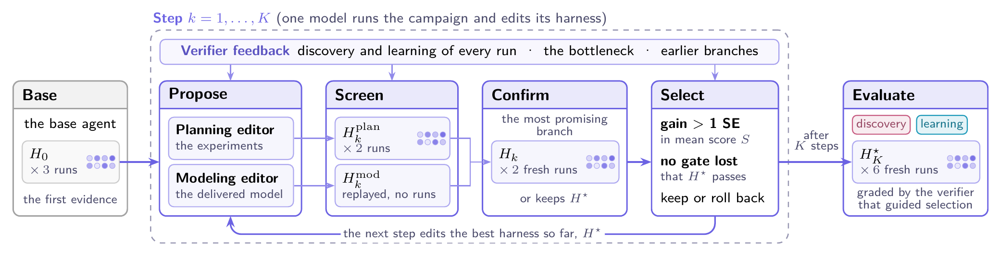
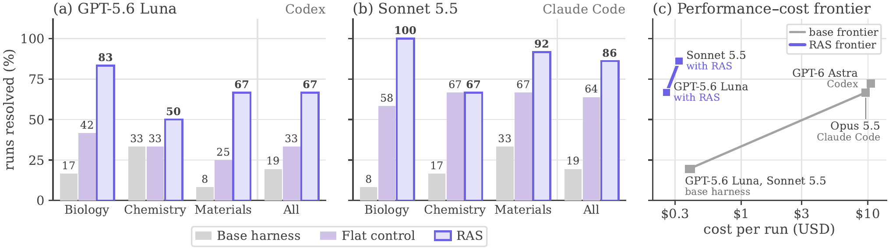

<h1 align="center">Recursive Autonomous Science</h1>

<p align="center">
  <strong>RAS</strong> lets an AI scientist <strong>get better at science by rewriting its own instructions</strong>. After each round of experiments, the agent edits its <em>harness</em> (the prompts, skills, and scripts around a <strong>frozen model</strong>) and keeps an edit only if fresh experiments confirm that it helps.
</p>

<p align="center">
  <a href="https://ras.autonomous-science-bench.ai"></a>
  <a href="https://arxiv.org/abs/2610.18449"></a>
  <a href="https://open-ssi.org"></a>
</p>

<p align="center">
  
</p>
<p align="center">
  <em>The RAS pipeline on one campaign. Each step calls the editors the bottleneck needs, screens their branches, and keeps the best one only if fresh runs confirm a gain beyond one standard error.</em>
</p>


## How it works

RAS runs on Autonomous Science Bench, a set of budgeted lab campaigns in biology, chemistry, and materials science. An agent passes a campaign only if it clears two gates: **discovery** (its experiments found enough of what the campaign is looking for) and **learning** (the model it delivers ranks unseen designs well).

A recursion starts with three runs of the unmodified agent. Then, at each of K steps, RAS:

1. **Diagnoses** every run's verdict to find the weaker gate.
2. **Proposes** edits with a planning editor (the experiments), a modeling editor (the delivered model), or both.
3. **Screens** each branch by replaying past runs, simulating from real runs, or running it twice.
4. **Confirms** the most promising branch on fresh runs, and keeps it only if the gain exceeds one standard error.

Each step builds on the best harness so far, which is what makes the process recursive. After the last step, the selected harness is evaluated on fresh runs that never helped choose it.

Editors never see the verifier's labels, and an answer guard keeps designs and prebuilt predictors out of every harness.

## Results

<p align="center">
  
</p>
<p align="center">
  <em><strong>RAS raises GPT-5.6 Luna from 19% to 67% and Sonnet 5.5 from 19% to 86%</strong> of runs resolved, against 33% and 64% for the flat control (the same steps without recursion), matching or exceeding Opus 5.5 and GPT-6 Astra at about a thirtieth of their cost per run.</em>
</p>

Runs that pass both gates, out of 6 per campaign:

| Campaign | Luna Base | Luna Flat | Luna RAS | Sonnet Base | Sonnet Flat | Sonnet RAS |
|---|---|---|---|---|---|---|
| Nuclease | 0/6 | 1/6 | 5/6 | 1/6 | 3/6 | 6/6 |
| Biosensor | 2/6 | 4/6 | 5/6 | 0/6 | 4/6 | 6/6 |
| Propylene | 1/6 | 1/6 | 1/6 | 1/6 | 2/6 | 2/6 |
| Suzuki | 3/6 | 3/6 | 5/6 | 1/6 | 6/6 | 6/6 |
| OER | 1/6 | 1/6 | 5/6 | 4/6 | 3/6 | 5/6 |
| Coercivity | 0/6 | 2/6 | 3/6 | 0/6 | 5/6 | 6/6 |
| **Total** | **7/36** | **12/36** | **24/36** | **7/36** | **23/36** | **31/36** |

**Base** is the unmodified agent. **Flat** takes the same number of steps but always edits the base harness. **RAS** edits the best harness so far.

## Quick start

You need Python 3.13, [uv](https://docs.astral.sh/uv/), Docker, and credentials for the model you run.

**1. Install RAS and the benchmark side by side.**

```bash
git clone https://github.com/Open-SSI/RAS.git
git clone https://github.com/Open-SSI/autonomous-science-bench.git as-bench
git -C as-bench checkout e27a890de1b294760abdcc32f00634111b70e47b
cd RAS
uv sync
cp .env.example .env    # then add your keys
```

RAS pins the benchmark to that commit and looks for it at `../as-bench`. Both are set in [`config/study.toml`](config/study.toml).

**2. Check the setup.**

```bash
uv run python -m ras check                     # the benchmark is at its pinned commit
uv run python -m ras preflight --env docker    # every campaign and executor, before a study spends anything large
```

**3. Run one recursion.**

```bash
uv run python -m ras run --executor luna --campaign coercivity-peak-search --recursion 1 --env docker
```

This runs the base agent three times, takes four improvement steps, and evaluates the selected harness on three fresh runs. Results go to `runs/`. A stopped recursion resumes where it stopped, and `uv run python -m ras status` shows progress.


## Citation

```bibtex
@misc{wen2026ras,
  title={Recursive Autonomous Science through Self-Improving Agent Harnessing},
  author={The OpenSSI Team},
  year={2026}
}

@article{wen2026autonomous,
  title={Autonomous Science Bench: Evaluating AI Agents for Autonomous Scientific Discovery},
  author={Yibo Wen and Han Liu},
  journal={arXiv preprint arXiv:2610.18449},
  year={2026},
  url={https://arxiv.org/abs/2610.18449}
}
```

## License

RAS is released under the [MIT License](LICENSE).
